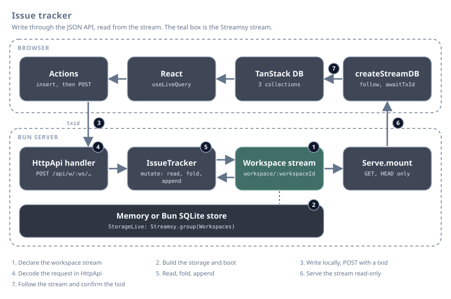

# Issue tracker demo

A complete Streamsy application with an Effect backend. An `HttpApi` handler
reads the workspace stream from the beginning, folds it into Durable State,
validates the mutation, and appends one conditional change. The browser replays
that same stream into TanStack DB with `@durable-streams/state/db`.



The [guide](https://streamsy.dev/docs/demos/issue-tracker) explains each
numbered step with excerpts from this folder.

## Run it

From the repository root:

```bash
bun install --frozen-lockfile
bun run build
bun run --cwd examples/issue-tracker-demo dev
```

Open <http://localhost:1338>. The seeded `main` workspace is ready immediately;
the share control creates isolated workspaces with their own stream.

| Variable           | Default       | Meaning                                               |
| ------------------ | ------------- | ----------------------------------------------------- |
| `PORT`             | `1338`        | HTTP port                                             |
| `ISSUE_TRACKER_DB` | unset         | SQLite file; unset keeps a process-local store        |
| `NODE_ENV`         | `development` | `production` turns off hot reload and console echoing |

Set `ISSUE_TRACKER_DB` when state should survive a server restart:

```bash
ISSUE_TRACKER_DB=.data/issues.sqlite bun run --cwd examples/issue-tracker-demo dev
```

Create the parent directory before starting the server.

## How it works

`server/index.ts` is one layer graph, launched with
`BunRuntime.runMain(Layer.launch(...))`. `Config` reads `PORT`,
`ISSUE_TRACKER_DB` and `NODE_ENV`. The graph opens storage, builds the
`IssueTracker` service, seeds the `main` workspace, and then starts the
listener. `BunHttpServer.layer` keeps Bun's HTML bundle and hot reload for
`/*`; `/api` and `/streams` fall through to one Effect `HttpRouter`. That
router holds two things: `HttpApiBuilder.layer(IssueTrackerApi)` for the JSON
API, and `Serve.mount(Workspaces, "/streams/workspace/:workspaceId")` from
`@streamsy/serve` for the read-only Durable State route. On SIGINT or SIGTERM
the layer scopes close in reverse order: `drainOnShutdown` answers parked long
polls with 204, the listener stops, and storage closes last.

`shared/api.ts` declares `IssueTrackerApi`: one group each for workspaces,
projects, issues and comments. Effect schemas in `shared/api-schema.ts` check
the workspace id, the partial entity body and its optional `txid`, and describe
the success bodies and the `{ "error": string }` error bodies. The same entity
schemas in `shared/state-schema.ts` type the stream collections on the server
and, through `Schema.toStandardSchemaV1`, the StreamDB collections in the
browser.

`IssueTracker.mutate` is the read, decide, append recipe in one
`Workspaces.decide` call: fold the workspace's State changes, validate against
the resulting view, and append with `expectedOffset`. `decide` retries on an
`OffsetMismatch` only, so parallel writers cannot silently overwrite one
another; after three retries the API answers 409. The validation rules in `server/state.ts` return
the change to append or a typed error, and the handlers map those errors to
400, 404 or 409. Project, issue, and comment changes share one
`Streamsy.state` declaration, `Workspaces`, whose collections type both reads
and writes. `DurableState.changes` stamps each change for the append. Because
the tracker appends its own events rather than projecting an upstream, each
change records the workspace head that `decide` read as its source offset.

The server keeps no workspace cache. In the browser, `createStreamDB` follows
the public workspace stream and exposes projects, issues, and comments as
TanStack DB collections, including optimistic writes keyed by the transaction
id returned from the API.

## Verify

```bash
bun run --cwd examples/issue-tracker-demo test:unit
bun run --cwd examples/issue-tracker-demo typecheck
bun run --cwd examples/issue-tracker-demo smoke:http
```

The offline HTTP smoke calls the API through an `HttpApiClient` built from
`IssueTrackerApi`. It covers projects, issues, comments, workspace isolation,
ten concurrent writers landing with the exact event count and no duplicates,
raw probes for bodies the typed client cannot send, raw stream writes (405), a
shutdown that drains a parked read with 204, and a SQLite process restart. The in-process
recipe tests use a read barrier to force a CAS conflict and prove that the
losing writer retries against the new state, and a writer that loses every race
to prove the 409 after three retries.

## Limits

With no database path, restarting the server starts with a fresh memory store.
Every mutation replays one complete workspace, so the recipe suits small
workspaces, not a large-workspace read model. Shared workspace ids are
unguessable-ish links, not an authorization boundary.

Guide: [streamsy.dev/docs/demos/issue-tracker](https://streamsy.dev/docs/demos/issue-tracker).
